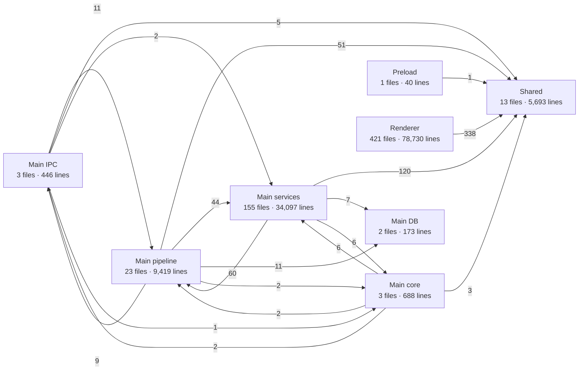
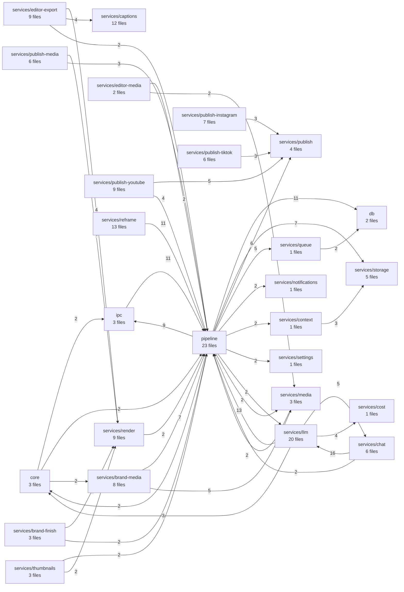

# Clipfern module graph

Generated from the real `import`s of 621 TypeScript files (`shared/`, `electron/`, `renderer/`; tests, the generated migration file and the Python sidecar excluded). Numbers on an arrow are the count of import statements from one module group to another. Regenerate with the script in the PR description or by asking for a refresh.

## Layers

## Main process: who depends on whom

Only links with 2+ imports are drawn. `pipeline` is the orchestration layer; `services/*` are the leaf capabilities (media, llm, captions, publish-_, brand-_, …).

## Largest module groups

| Group                         | Files | Lines  |
| ----------------------------- | ----- | ------ |
| `ui/components/editor`        | 99    | 19,427 |
| `ui/lib/editor`               | 54    | 12,562 |
| `main/pipeline`               | 23    | 9,419  |
| `ui/components/brand`         | 23    | 5,920  |
| `shared`                      | 13    | 5,693  |
| `ui/components/library`       | 14    | 5,585  |
| `main/services/llm`           | 20    | 4,771  |
| `ui/components/scheduler`     | 16    | 4,746  |
| `ui/other`                    | 34    | 4,210  |
| `ui/components/settings`      | 14    | 3,082  |
| `ui/components/pages`         | 14    | 3,060  |
| `main/services/editor-export` | 9     | 2,904  |
| `main/services/captions`      | 12    | 2,896  |
| `ui/components/ui`            | 35    | 2,413  |
| `main/services/reframe`       | 13    | 2,115  |
| `main/services/brand-media`   | 8     | 2,027  |
| `main/services/render`        | 9     | 2,019  |
| `ui/lib/brand`                | 10    | 1,835  |

## Most imported files (fan-in)

| File                                  | Imported by |
| ------------------------------------- | ----------- |
| `renderer/lib/utils.ts`               | 156         |
| `shared/editor.ts`                    | 130         |
| `renderer/components/ui/button.tsx`   | 108         |
| `shared/pipeline.ts`                  | 105         |
| `shared/cp2.ts`                       | 75          |
| `renderer/lib/ipc.ts`                 | 63          |
| `shared/brand.ts`                     | 55          |
| `shared/editor-eval.ts`               | 54          |
| `renderer/components/ui/skeleton.tsx` | 53          |
| `renderer/lib/format.ts`              | 50          |
| `renderer/components/ui/tooltip.tsx`  | 47          |
| `shared/publish.ts`                   | 42          |

## Reading it

- `Shared` (the Zod IPC contract and the pure evaluators `editor-eval`, `scheduling`, `brand-apply`) is imported by every layer and imports nothing from them: that is the intended direction.
- The renderer reaches the main process only through `Preload` / IPC; there should be no arrow from `Renderer` to any `Main *` group.
- `Main pipeline` is where services are combined. The many `services/* → pipeline` arrows are only imports of the `pipeline/contracts*.ts` interface files (checked: no service imports any other pipeline file). That is the contract-first design, so the interfaces live next to the orchestrators that consume them.
