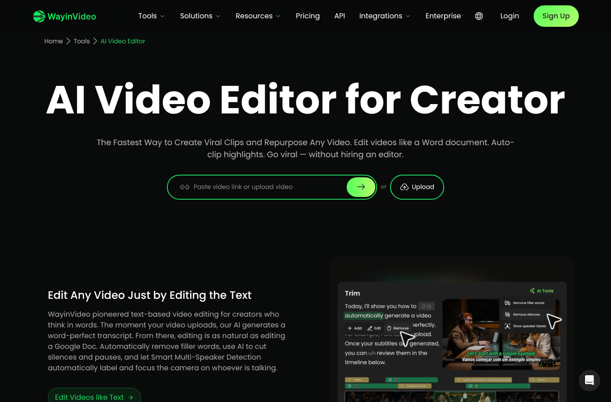
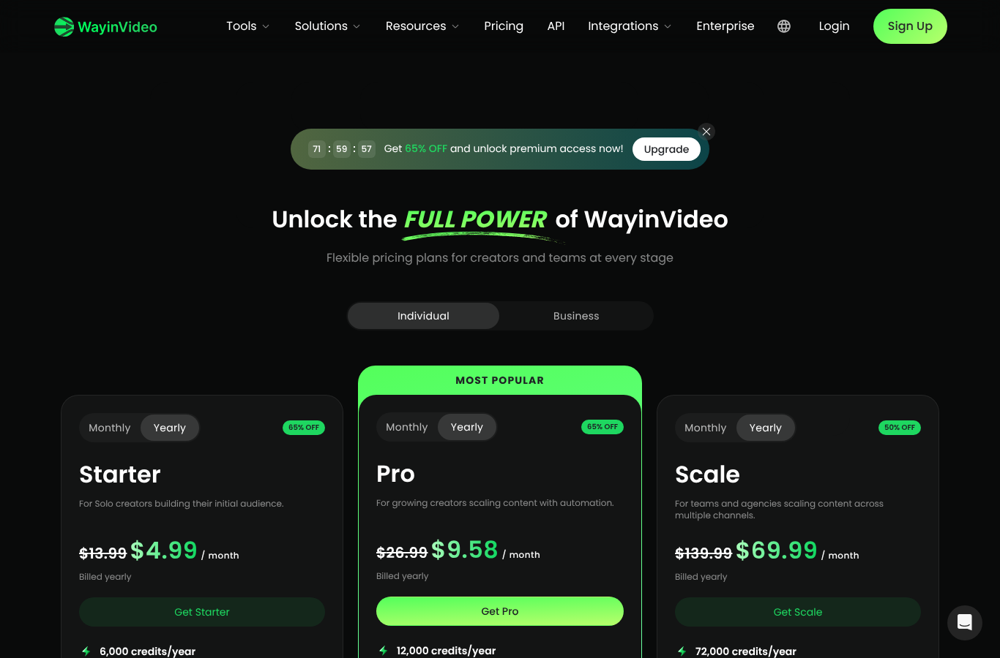

# WayinVideo teardown (outside-in observation)

Observation and documentation only. No code, assets or private API calls from Wayin were used.
Sources: public pages on wayin.ai (loaded in a headless browser on 2026-10-12), the public help center
(intercom.help/wayinvideo) and web search. Screenshots are in `docs/img/`.

> **Status:** sections 1–5 and 7–8 are done. **Section 6 (the logged-in results page) is pending**:
> it needs the user to log in themselves in their own browser.

---

## 1. What the product is
An all-in-one "long video → short clips" cloud app. Its main clipping tools:

| Tool | What it does |
|---|---|
| **AI Clipping** | Automatic: finds highlight moments from dialogue **and** visual context, cuts clips, scores each one |
| **Find Moments** | Prompted: "find moments where X" returns matching clips, each with a score |
| **Game Clipping** | AI Clipping tuned for gameplay / stream VODs |
| **AI Reframe** | 16:9 → 9:16 / 1:1 with subject tracking and layout templates |
| **Video Editor** | Text-based editing plus a timeline; subtitles, hook, B-roll, music, transitions |
| Publish | Content calendar, auto-posting to connected socials, thumbnails, title/description/hashtags |

Also: transcripts, summaries, translation, dubbing, an API, a Chrome extension and a desktop app.

## 2. UX flow (from public pages + help center)
1. **Input**: paste a link (YouTube, Twitch, Zoom, podcast platforms) or upload a file (MP4/MOV/AVI), or record.
2. **Settings**: language and clip length (**Shorter / Medium / Longer**). AI Clipping takes no prompt;
   prompts belong to Find Moments.
3. **Processing**: the AI "watches" the video, then cuts, scores and ranks the clips.
4. **Results grid**: several clips, each with a **Viral Score**. The help center calls them "a shortlist" and suggests sorting by score.
5. **Editor**: trim, subtitles, reframe/layout, AI Hook, text, B-roll, music, transitions, thumbnail, title/description/hashtags.
6. **Export / publish**: download (resolution depends on plan) or schedule to socials.

## 3. Feature inventory

| Area | What Wayin offers (as documented) |
|---|---|
| Clip length | Three presets. The help center gives **no second ranges**. Shorter: hooks, reactions, jokes, memes. Medium: complete answers, stories, Q&A. Longer: setup → payoff, context-heavy. Default advice: "start with medium". |
| Moment detection | Speech + visuals (reactions, scene changes, demos, on-screen products/UI) |
| Viral Score | Overall number (0–100 per the marketing FAQ, e.g. "99/100") free for everyone; the **dimension breakdown is paid** (see §4) |
| Captions | "Basic and Dynamic" styles; key phrases "pop in color and scale"; word-by-word; max characters per line; show/hide punctuation; AI emojis; translated or bilingual subtitles; SRT download |
| AI Hook | Opening text overlay for the first seconds. The documented example contrasts *"You need to hear this"* (vague) with *"This one edit makes the clip much easier to watch"* (specific) |
| Reframe layouts | Auto, Full, Fit, Split (2 speakers), Trio, Grid, PiP, Screen First, Gameplay; blurred-background template |
| Speaker | "Smart Multi-Speaker Detection": labels speakers and focuses the frame on whoever is talking |
| Text editing | Delete words → video cut; remove filler words and silences automatically |
| Extras | AI B-roll, AI music/SFX, transitions, speech enhancement, brand kit, templates, montage |
| Metadata | Generated title, description, hashtags; AI thumbnail |
| Export | 720p (free, files expire after 3 days) / 1080p / 2K / 4K depending on plan; bulk export of 20–50 clips |

## 4. Viral Score: what it measures
The help center article *"What does clip quality or viral score mean?"* is the authoritative source:
- **Hook**: grabs attention in the first few seconds (surprising statement or visual, a question, high energy, a clear promise). Weak = slow start, "a conversation the viewer missed".
- **Story**: complete beginning, middle and end **with a payoff**; "even a 15-second clip can be self-contained".
- **Value**: a useful tip, surprising fact, emotional moment, something relatable, or information. Fails the "so what?" test → low.
- **Engagement**: likely to get likes, comments, shares and saves; tied to Value and Story; varies by platform.
- **Reach**: can it travel beyond the existing audience (universal topic, broad appeal, understandable without sound, trend fit). Described as **"the ceiling"**.
- Paid users get **letter grades per dimension (A, A−, …) plus text feedback**. Free users get only the number.
- "A recommendation signal, not a promise." A high Hook with no payoff still disappoints.

The marketing FAQ disagrees with this: it describes four dimensions (hook in the first 3s, edit pacing,
topic trendiness, caption keyword density). I treat the help center's five dimensions as the real model.

## 5. Pricing and limits (2026-10-12)

| Plan | Price (yearly billing, discounted) | Credits | Export | Notes |
|---|---|---|---|---|
| Free | $0 | 100 one-time | 720p, files kept 3 days | no bulk export, no auto-post |
| Starter | $4.99/mo (list $13.99) | 6,000/yr | 1080p | bulk export 20 clips |
| Pro | $9.58/mo (list $26.99) | 12,000/yr | 2K | brand kit, **AI hook**, B-roll |
| Scale | $69.99/mo (list $139.99) | 72,000/yr | 4K | 4 seats |

The pricing page says "1 credit processes 1 min of source video". A Spanish pricing page and the help center
cite 2 credits/min for AI Clipping, so the sources conflict. **AI Hook and the score breakdown are paywalled.**

## 6. Logged-in results page (video `dnA561etoTM`): PENDING
Video: *"Así es Como Encuentro Productos Ganadores Para Ganar 20.121€ Este Q4"* by Pablo Pérez,
15:33, Spanish. To fill in once the user logs in through their own browser:
- [ ] Per clip: title, length, start/end timestamps, viral score, dimension grades and text, hook text
- [ ] Caption style, layout, editing controls, export options (screenshots → `docs/img/wayin-results-*.png`)
- [ ] Pattern analysis: typical length, sentence alignment of start/end, hook phrasing, high vs low score traits

## 7. Patterns (from documentation; to be confirmed against §6)
- **Start**: the first line must work cold. Clips that open mid-conversation score low on Hook.
- **End**: must land a payoff; a clip that feels cut off fails Story.
- **Length**: chosen to fit the moment, not minimized ("shorter is not always better"). Instagram guidance on the page: 15–30s highlights perform best, with Reels up to 90s.
- **Hooks**: specific beats vague. They state the concrete promise or tension of the clip.
- **Score is relative**: it's meant for sorting a shortlist. A low Reach can still fit a niche audience.

## 8. Gaps and weaknesses (my opportunity)
1. **No campaign awareness.** Nothing checks a clip against a brand's written requirements, which is exactly what Whop pays or rejects on (brands may reject *only* for violating written requirements).
2. **Originality isn't a feature.** One render per moment, so many clippers on the same campaign post near-identical clips.
3. **The score explanation is paywalled**, and the dimensions come with no concrete fix suggestions.
4. **Length presets are vague** (no second ranges), while campaigns state exact limits like "30–60s".
5. **Find Moments results don't document timestamps.**
6. **Credits and cloud queue**: you pay per source minute, free exports expire in 3 days, and you wait in a shared queue.
7. **No per-platform output bundle** with metadata for TikTok, Shorts, Reels and X side by side.

---
### Sources
- [wayin.ai: AI Video Editor](https://wayin.ai/tools/ai-video-editor/) · [Instagram clip maker](https://wayin.ai/tools/clip-maker/instagram/) · [Pricing](https://wayin.ai/pricing/)
- Help center: [How to use AI Clipping](https://intercom.help/wayinvideo/en/articles/15691718-how-to-use-ai-clipping) · [How to create your first clip](https://intercom.help/wayinvideo/en/articles/15913331-how-to-create-your-first-clip) · [Viral score](https://intercom.help/wayinvideo/en/articles/16209720-what-does-clip-quality-or-viral-score-mean) · [Better results](https://intercom.help/wayinvideo/en/articles/15913606-how-to-get-better-ai-clip-results) · [Length & prompts](https://intercom.help/wayinvideo/en/articles/16210181-how-to-control-clip-results-with-length-and-prompts) · [Find Moments](https://intercom.help/wayinvideo/en/articles/15691741-how-to-use-find-moments) · [AI Hook](https://intercom.help/wayinvideo/en/articles/15692165-how-to-create-an-ai-hook) · [Editor overview](https://intercom.help/wayinvideo/en/articles/16210969-video-editor-overview) · [Reframe](https://intercom.help/wayinvideo/en/articles/15692069-how-to-resize-and-reframe-a-clip) · [Subtitles](https://intercom.help/wayinvideo/en/articles/15692093-how-to-add-and-edit-subtitles) · [Plans](https://intercom.help/wayinvideo/en/articles/15692322-how-wayinvideo-plans-work)
- Whop: [Content Rewards docs](https://docs.whop.com/manage-your-business/growth-marketing/content-rewards) · [Why Whop clips get rejected (FindClout)](https://findclout.com/blog/why-whop-clips-get-rejected) · [Content Rewards brand terms](https://contentrewards.com/terms-of-service/brands)
